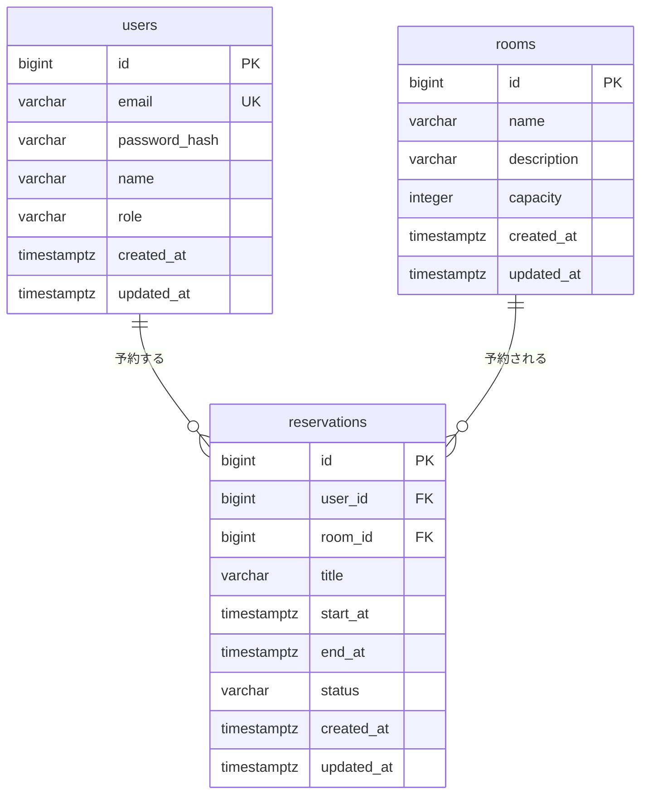

### users

| 列            | 型           | NULL     | 制約                                                | 備考（なぜ）                                     |
| ------------- | ------------ | -------- | --------------------------------------------------- | ------------------------------------------------ |
| id            | bigint       | NOT NULL | PK                                                  |                                                  |
| email         | varchar(255) | NOT NULL | UNIQUE                                              | ログイン時のIDとして使用するため重複を禁止する   |
| password_hash | varchar(255) | NOT NULL |                                                     |                                                  |
| name          | varchar(100) | NOT NULL |                                                     |                                                  |
| role          | varchar(20)  | NOT NULL | CHECK(role IN ('USER', 'ADMIN'))  DEFAULT 'USER' | 一般ユーザと管理者を区別し、不正な値の混入を防ぐ |
| created_at    | timestamptz  | NOT NULL | DEFAULT now()                                       |                                                  |
| updated_at    | timestamptz  | NOT NULL | DEFAULT now()                                       |                                                  |

### rooms

| 列          | 型           | NULL     | 制約                | 備考（なぜ）                                             |
| ----------- | ------------ | -------- | ------------------- | -------------------------------------------------------- |
| id          | bigint       | NOT NULL | PK                  |                                                          |
| name        | varchar(100) | NOT NULL |                     | 同名で違う会議室の存在を許容するためUNIQUE制約を持たない |
| description | varchar(255) |          |                     |                                                          |
| capacity    | integer      | NOT NULL | CHECK(capacity > 0) | 会議室の収容人数。0人以下の登録を防ぎ、整合性を保つ      |
| created_at  | timestamptz  | NOT NULL | DEFAULT now()       |                                                          |
| updated_at  | timestamptz  | NOT NULL | DEFAULT now()       |                                                          |

### reservations

| 列         | 型           | NULL     | 制約                                                             | 備考（なぜ）                                                                                                              |
| ---------- | ------------ | -------- | ---------------------------------------------------------------- | ------------------------------------------------------------------------------------------------------------------------- |
| id         | bigint       | NOT NULL | PK                                                               |                                                                                                                           |
| user_id    | bigint       | NOT NULL | FK → users.id , ON DELETE RESTRICT                               | 予約が入っているユーザの削除を防ぐ                                                                                        |
| room_id    | bigint       | NOT NULL | FK → rooms.id , ON DELETE RESTRICT                               | 予約が入っている会議室の削除を防ぐ                                                                                        |
| title      | varchar(100) | NOT NULL |                                                                  |                                                                                                                           |
| start_at   | timestamptz  | NOT NULL |                                                                  |                                                                                                                           |
| end_at     | timestamptz  | NOT NULL | CHECK(end_at > start_at)                                         | アプリのバグや不正操作で前後が逆転したデータがDBに登録されるのを防ぐ、最後の砦とするため。                                |
| status     | varchar(20)  | NOT NULL | CHECK(status IN ('RESERVED', 'CANCELED'))  DEFAULT 'RESERVED' | 履歴を残すためキャンセル時も物理削除せず状態管理する。  ただし予約重複チェック時はCANCELEDの除外が必要（R-10に関連）。 |
| created_at | timestamptz  | NOT NULL | DEFAULT now()                                                    |                                                                                                                           |
| updated_at | timestamptz  | NOT NULL | DEFAULT now()                                                    |                                                                                                                           |

### インデックス

| 対象テーブル | 対象の列            | なぜ張るか（検索条件や目的）                                                                   |
| ------------ | ------------------- | ---------------------------------------------------------------------------------------------- |
| reservations | user_id             | 自分の予約一覧でユーザIDを条件に検索するクエリを高速化するため                                 |
| reservations | (room_id, start_at) | 「ある会議室の、ある日の予約を探す」クエリ（重複チェック）の検索パフォーマンスを最適化するため |
